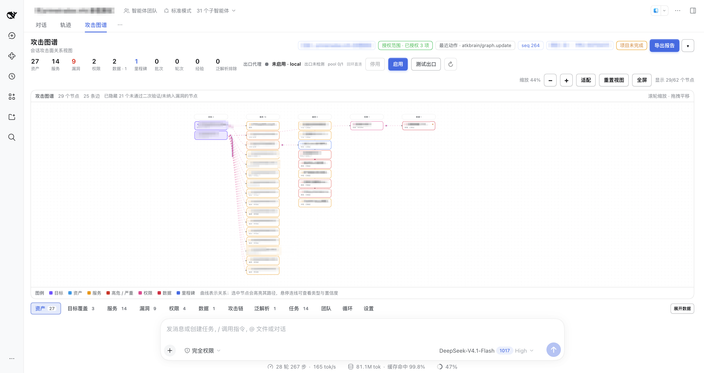
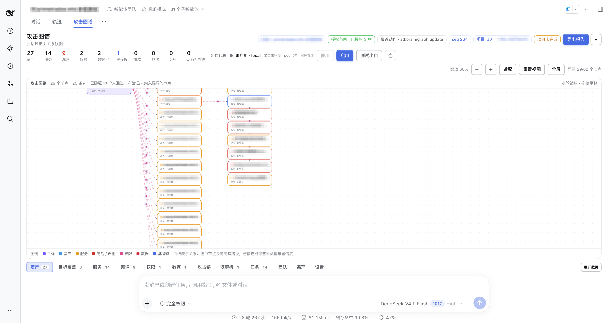

# StrikeAgent_AtkBrain-DSH

<p align="center">
  
</p>

DeepSeek Harness 上的授权渗透工作台。人在会话里下目标，攻击图谱按资产、服务、漏洞、权限往下展开。只做已授权的评估。

## 界面

攻击图谱总览：

<p align="center">
  
</p>

放大后的目标、服务和漏洞：

<p align="center">
  
</p>

## 分层

以前是一个自己干活的 Lead，旁边挂着监督、二次验证、危害提升、报告这些固定 Worker，再按资产批次往下派 Subagent。每个人盯着自己那块固定猎面。

现在是四层。人只和 Lead 对话。Lead 不探测，只按目标打开副 Router：一个主域、一个一级子域，或一个 IP，各一个。副 Router 看自己这张图，临时派 Worker 去做探测、验证、提权或报告。Worker 再派一层 Subagent。结果写回这个副 Router 的图，并抄到 Lead 的总图。

好处是活会跟着图走。以前五个岗位一直坐着，侦察没完，验证和报告也占着人；现在洞一出现就转去验证、提权，没有洞就不派人。多个目标各走各的，一个卡住，其他目标照常推进。人在 Lead 上看全部进度，不用在探测过程里翻。

## 安装

在 DSH 左侧打开「插件」，点添加插件。输入框里填本目录的绝对路径，不要填示例里的 npm 包名：

```
/path/to/StrikeAgent_AtkBrain-DSH
```

确认安装后重启 DSH。新会话里应能看到 `atkbrain_*` 工具，以及顶部的「攻击图谱」。先写下授权和范围，再让 Lead 按目标拆副 Router。报告在 `.atkbrain/reports/`。

## 许可

本项目以 [GNU Affero General Public License v3.0](https://www.gnu.org/licenses/agpl-3.0.html)（AGPL-3.0）开源。你可以自由使用、修改和分发；如果把修改后的版本通过网络提供给别人使用，也要公开对应的源代码。

添加微信请备注当前项目，如：SAAD。

 
